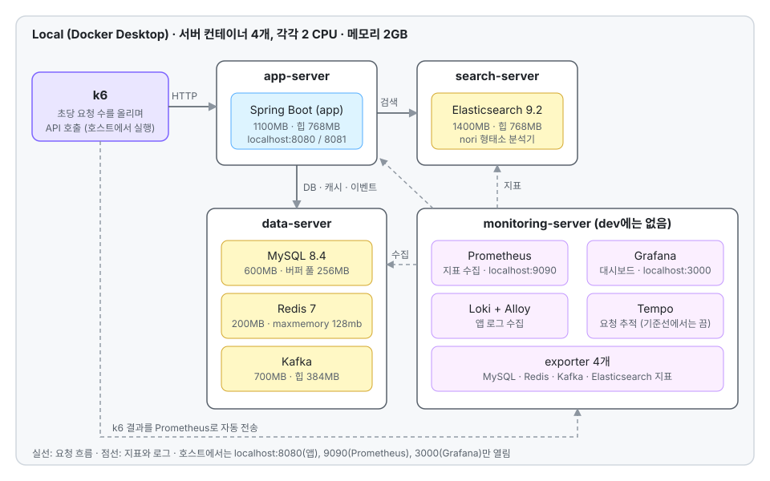

# imhungry-performance-testing

**냉장고를 부탁해** 서비스 API의 부하를 로컬에서 측정하는 저장소입니다.
dev.imhungry.click과 같은 서버 구성을 컨테이너로 만들고, 같은 시나리오를 개선 전과 후에 같은 조건으로 돌려 숫자로 비교합니다.

<p>
  
  
  
  
</p>

## 한눈에 보기

- **목표**: 개선 전과 후를 **같은 조건에서** 측정해 숫자로 비교
- **환경**: 서버 4대(앱·데이터·검색·모니터링)를 컨테이너로 만들어 dev.imhungry.click과 같은 메모리 제한으로 실행, `env/up.sh` 하나로 올림
- **부하**: k6. 읽기 API는 초당 요청 수를 200 → 2,000건으로 올리고, 상태를 바꾸는 API는 DB 최종 상태로 정확성을 확인
- **관측**: Prometheus·Grafana·Loki·Tempo. k6 결과는 Prometheus로 자동 전송
- **기준**: 같은 조건으로 3번 돌려 가운데 값을 사용. 측정하지 않은 것은 "미측정"
- **한계**: 숫자는 측정한 컴퓨터의 CPU·메모리·Docker 할당에 따라 달라지고 실제 배포 서버(ARM t4g, CPU 크레딧)와 같을 수 없으므로, 같은 컴퓨터에서 측정한 개선 전후 비교에만 사용

## 목차

1. [아키텍처](#1-아키텍처)
2. [왜 이렇게 만들었나](#2-왜-이렇게-만들었나)
3. [측정 방식](#3-측정-방식)
4. [결과](#4-결과)
5. [디렉터리 구조](#5-디렉터리-구조)
6. [시작하기](#6-시작하기)

## 1. 아키텍처



서버 컨테이너 4개가 각각 dev.imhungry.click의 서버 한 대(t4g.small, 2 CPU · 2GB)에 해당하고, 안쪽에서 Docker로 서비스를 띄웁니다. k6는 호스트에서 실행합니다.

| 서버&nbsp;&nbsp;&nbsp;&nbsp;&nbsp;&nbsp;&nbsp;&nbsp;&nbsp;&nbsp;&nbsp;&nbsp;&nbsp;&nbsp;&nbsp;&nbsp; | 안쪽 컨테이너와 메모리 제한 | 호스트에서 접속 |
| --- | --- | --- |
| `app-server` | Spring Boot 1100MB (힙 768MB, G1GC) | `localhost:8080`(앱), `8081`(관리 포트) |
| `data-server` | MySQL 8.4 600MB(버퍼 풀 256MB), Redis 7 200MB(maxmemory 128mb), Kafka 700MB(힙 384MB) | 열지 않음 |
| `search-server` | Elasticsearch 9.2 1400MB(힙 768MB, nori) | 열지 않음 |
| `monitoring-server` | Prometheus, Grafana, Loki, Alloy, Tempo, exporter 4개 | `localhost:9090`, `localhost:3000` |

<sub>서버 컨테이너는 모두 2 CPU, 메모리 2GB, 스왑 1GB입니다. dev.imhungry.click에는 모니터링 서버가 없습니다.</sub>

<details>
<summary>서버 컨테이너 안에 컨테이너를 띄우는 이유</summary>

dev.imhungry.click은 서버 한 대(2 CPU · 2GB)를 그 위의 컨테이너들이 나눠 씁니다. 컨테이너별 CPU 제한은 없고 메모리 제한만 있습니다. 서버를 바깥 컨테이너(2 CPU · 2GB)로 만들고 그 안에서 컨테이너를 실행하면 이 구조가 그대로 재현됩니다.

- **서버 단위로 CPU를 나눠 씁니다.** 데이터 서버에서 MySQL·Redis·Kafka가 2 CPU를 서로 경쟁하는 모습이 dev.imhungry.click과 같게 나옵니다. 컨테이너를 한 단계만 쓰면 제한을 안 두었을 때는 호스트 코어 전체를 쓰고, 컨테이너마다 제한을 두면 서로 경쟁하지 않아서 이 모습을 만들 수 없습니다.
- **서버 단위로 CPU 사용량을 볼 수 있습니다.** 다만 어느 서버에서 먼저 막히는지는 이 환경의 관찰이라 dev.imhungry.click에서도 같다고 보지 않습니다.
- **메모리도 서버 단위로 나눠 씁니다.** 서버 2GB 안에서 컨테이너별 제한(MySQL 600MB, Redis 200MB, Kafka 700MB 등)이 함께 적용됩니다.

**알아 둘 점**
- 구성이 복잡합니다. 안쪽 컨테이너에 메모리 제한을 걸려면 안쪽 Docker를 띄우기 전에 cgroup에 메모리 제어를 위임해야 하고(`env/create-server.sh`가 해 줌), 서버 컨테이너를 껐다 켜면 안쪽 Docker를 다시 살려야 합니다(`env/recover-server.sh`).
- 안쪽 컨테이너에 `docker exec`로 들어가는 명령(DB 확인, Redis 명령)은 한 번에 약 3초가 걸립니다(`select 1`도 같음). 이 시간은 쿼리 시간이 아니므로 손으로 쿼리 시간을 측정할 때는 빼야 합니다.
- k6 요청은 `docker exec`를 거치지 않고 `localhost:8080`으로 앱에 바로 들어가므로 요청마다 3초가 드는 것이 아닙니다(낮은 부하에서 앱 응답이 수 ms로 나옴). 다만 서버 컨테이너 한 단계가 추가되는 만큼의 지연과 CPU 오버헤드는 따로 측정하지 않았습니다(미측정).
</details>

## 2. 왜 이렇게 만들었나

### 2-1. dev.imhungry.click과 동일한 것과 다른 것

- **동일**: 서버 3대 구성(앱, 데이터, 검색), 서버당 2 CPU · 2GB, 컨테이너별 메모리 제한과 JVM 힙(`-Xms768m -Xmx768m -XX:+UseG1GC`), 컨테이너별 CPU 제한 없음
- **추가**: 모니터링 서버 1대(dev.imhungry.click에는 없음)
- **다름**: CPU 종류(dev.imhungry.click은 ARM t4g), CPU 크레딧에 따른 버스트 제한(로컬에서는 재현하지 못함), 서버 사이 네트워크(로컬은 같은 컴퓨터)
- **영향**: 서버 4대가 한 컴퓨터의 CPU를 나눠 써서, 다른 프로그램이 CPU를 쓰면 숫자가 흔들립니다

이 차이 때문에 측정한 절대값은 dev.imhungry.click 성능으로 그대로 쓰지 않습니다. **같은 조건의 개선 전후 비교와 요청 1건의 작업량**(요청당 SQL 문 수, 트랜잭션 수, 실행 계획)만 봅니다. 어느 서버에서 먼저 막히는지는 환경에 따라 달라 결론으로 쓰지 않습니다.

### 2-2. 앱은 소스코드 저장소에 두고 측정용 변경만 얹습니다

테스트하는 앱은 [소스코드 저장소 `take-care-of-my-fridge`](https://github.com/sparta-final-4/take-care-of-my-fridge)에 있습니다. 측정에는 메트릭 수집과 `loadtest` 프로필이 필요한데 소스코드 저장소의 dev 브랜치에는 없는 변경이라, 이 저장소의 `app-patch/loadtest-app.patch`로 보관합니다. `env/up.sh`가 소스코드 저장소에서 체크아웃된 커밋을 임시 폴더에 꺼내 패치를 얹어 빌드하므로 소스코드 저장소의 작업 폴더는 건드리지 않습니다. 측정한 앱 커밋은 이미지 라벨에 남습니다.

## 3. 측정 방식

- **같은 조건**: 개선 전(기준선)과 후는 같은 환경·같은 데이터·같은 부하 조건에서 측정하고, 3번 돌려 가운데 값을 씁니다
- **초당 요청 수 고정**: 읽기 API는 사용자 수가 아니라 초당 요청 수를 올립니다. 사용자 수로 고정하면 응답이 빠를수록 더 많이 보내서 전후를 비교할 수 없습니다
- **DB 상태로 확인**: 상태를 바꾸는 시나리오(주문, 장바구니 담기)는 응답이 아니라 DB 최종 상태로 정확성을 먼저 확인합니다. 틀리면 속도 숫자는 기록하지 않습니다
- **캐시 전후**: 캐시가 걸린 API(이번 달 많이 만든 레시피, 레시피 분류)는 캐시 없음과 캐시 적용을 둘 다 측정합니다
- **조용한 호스트**: 측정 전에 다른 프로그램(브라우저, IDE, 화상 통화)을 닫고, 호스트 CPU가 바쁘면 측정하지 않습니다. 호스트가 바쁜 상태에서 측정한 회차는 숫자를 쓸 수 없습니다
- **측정한 것만**: 측정한 값만 적고, 측정하지 않은 것은 "미측정"으로 적습니다

<details>
<summary>읽기 API 공통 부하 옵션</summary>

`lib/read.js`가 모든 읽기 시나리오에 같은 방식을 적용합니다. 초당 요청 수를 단계별로 올립니다(`ramping-arrival-rate`). 각 단계는 평평한 구간이 아니라 이전 속도에서 목표 속도까지 올라가는 구간입니다.

- `RATES`: 단계별 `초당 요청 수[:초]`(쉼표 구분). 기본 `200:30,500:60,1000:60,2000:60`
- `STEP_SEC`: 시간을 적지 않은 단계의 초. 기본 60
- `SMOKE=1`: 초당 5 → 10건, 단계당 20초로 가볍게 먼저 돌려 스크립트와 서버를 확인(이 숫자는 기록하지 않음)
- `PLATEAU`, `PLATEAU_SEC`: 단계 상승 대신 그 속도까지 30초 올린 뒤 `PLATEAU_SEC`초(기본 120) 동안 고정. 개선 전후 비교용
- `MAX_DROPPED`: 못 따라간 요청(`dropped_iterations`)이 이 수를 넘으면 자동 중단. 기본 20,000

- 자동 중단: 시작 30초 뒤부터 누적 p95가 2000ms를 넘거나 실패율이 5%를 넘으면 멈춥니다. 최근 구간이 아니라 누적 값이라 잠깐 튀는 것은 못 막습니다.
- 한계 근처의 p95는 회차마다 크게 흔들립니다. 그래서 개선 전후는 비교할 속도(예: 초당 300건)를 정해 길게 유지하는 고정 속도(`PLATEAU`)로 비교합니다. 속도는 같은 세션의 단계형 결과로 정하고, 지난 세션의 값을 그대로 쓰지 않습니다.
</details>

<details>
<summary>상태를 바꾸는 시나리오(주문, 장바구니 담기) 실행</summary>

`tools/run-stateful.sh`가 한 회차를 호스트 부하 확인 → 앱 확인 → 되돌리기 → 실행 → DB 확인 → 되돌리기 → 앱 메모리 부족 종료 확인 순서로 돌립니다.

```bash
DB_USER=<사용자> DB_PASSWORD=<비밀번호> ./tools/run-stateful.sh \
  --reset scenarios/orders/orders-accuracy-reset.sql --verify scenarios/orders/orders-accuracy-verify.sql -- \
  -e ADMIN_PASSWORD=<로컬 관리자 비밀번호> scenarios/orders/orders-accuracy.js
```

- 장바구니 담기는 `--reset scenarios/cart-add/cart-add-reset.sql --verify scenarios/cart-add/cart-add-verify.sql`로 같은 방식으로 돌립니다. DB 확인 결과는 `results/<스크립트 이름>-<시각>-verify.txt`에도 남습니다.
- 시작 전 1분 부하 평균이 기준(`HOST_LOAD_MAX`, 기본 CPU 코어 수의 절반)을 넘으면 종료 코드 4로 멈춥니다. 읽기 시나리오(`run.sh`)에는 이 확인이 없습니다.
- 실행 뒤 앱이 응답하지 않거나 메모리 부족 종료 기록이 늘었으면 그 회차의 숫자를 쓰지 말라고 알리고 종료 코드 3으로 끝납니다.
- 번개 드롭은 관리자만 등록하므로 로컬 관리자 비밀번호를 `-e ADMIN_PASSWORD=…`로 넘깁니다(저장소에는 두지 않음).
- `orders-accuracy.js`의 기대: 주문 성공이 정확히 한정 수량(10), 남은 수량 0, 재고는 시작 재고에서 성공 수만큼 감소, 5xx 0건.
- `orders-burst.js`: 워밍업 30초 뒤 초당 50 → 100 → 250 → 500건으로 올립니다(`-e RATES=속도:초,…`). 4xx 거절(품절, 구매 한도 초과)은 정상이고 5xx만 실패로 봅니다.
- 주문은 5분 뒤 만료로 재고가 돌아가므로 측정은 5분 안에 끝내고 즉시 DB를 확인합니다.
- 같은 상품을 장바구니에 두 번 담으면 수량이 2가 되어 번개 드롭 1인 한도에 걸립니다. 다른 시나리오가 남긴 장바구니는 되돌리기 SQL로 지운 뒤 돌립니다.
</details>

<details>
<summary>준비 단계 속도, Prometheus 전송, 결과 표 만들기</summary>

- 회원 1,000명의 로그인·CSRF·장바구니 준비를 `lib/prepare.js`가 25명씩 묶어 동시에 보냅니다(`-e PREPARE_BATCH=25`). 로그인은 서버의 비밀번호 검증 때문에 서버 CPU 수 이상으로는 빨라지지 않습니다. 회원이 이미 있으면 가입 요청을 보내지 않습니다.
- k6 결과는 시작할 때 Prometheus(`localhost:9090`)가 응답하면 자동으로 전송되고, 응답이 없으면 파일만 남습니다(실행 첫 출력으로 확인). 실행마다 `testid=<스크립트>-<시각>` 태그가 붙어 Grafana 상단의 `k6 실행(testid)`에서 고를 수 있습니다. 보내지 않으려면 `NO_PROM=1`, 주소가 다르면 `PROM_URL`을 줍니다.
- 결과 표는 `python3 tools/summarize.py --prefix <스크립트 이름> --last 3 --steps <단계> --uri <경로> --method <메서드>`로 만듭니다. 결과 파일 이름의 날짜-시각으로 `--since`, `--until`을 줘서 확인용 실행이 섞이지 않게 합니다. 서버 지표 구간은 앱이 요청을 받기 시작한 시각에서 추정하므로 경계에 ±10초 정도 오차가 있습니다.
</details>

## 4. 결과

API별 보고서는 [`reports/`](reports/README.md)에 환경별로 나눠 둡니다. 로컬은 `reports/local/`, dev.imhungry.click은 `reports/dev/`이고, 그 아래 폴더 이름은 `scenarios/`와 같습니다. 환경이 다른 숫자는 섞지 않습니다.

### 4-1. 로컬

| API&nbsp;&nbsp;&nbsp;&nbsp;&nbsp;&nbsp;&nbsp;&nbsp;&nbsp;&nbsp;&nbsp;&nbsp;&nbsp;&nbsp;&nbsp;&nbsp; | 보고서 | 핵심 결과 |
| --- | --- | --- |
| GET /api/recipes/popular | [baseline.md](reports/local/recipes-popular/baseline.md) | 20명 동시 p95 중앙값: 캐시 없음 4,094ms → 캐시 적용 5.9ms |
| GET /api/recipes/classifications | [baseline.md](reports/local/recipe-classifications/baseline.md) | 2,000건/초까지 올렸을 때 p95 중앙값: 캐시 없음 51ms → 캐시 적용 1ms |
| GET /api/search/recipes | [recipes-baseline.md](reports/local/search/recipes-baseline.md) | 2,000건/초까지 올려도 자동 중단 없이 완주, p95 중앙값 36ms |
| GET /api/search/products | [products-baseline.md](reports/local/search/products-baseline.md) | 2,000건/초까지 올려도 자동 중단 없이 완주, p95 중앙값 3ms(상품 17개의 작은 데이터) |
| GET /api/products | [baseline.md](reports/local/products/baseline.md) | 2,000건/초까지 올려도 자동 중단 없이 완주, p95 중앙값 2ms(상품 17개의 작은 데이터) |
| GET /api/recipes | [baseline.md](reports/local/recipes/baseline.md) | 2,000건/초까지 올려도 자동 중단 없이 완주, p95 중앙값 2ms |
| GET /api/cart-items | [baseline.md](reports/local/cart-read/baseline.md) | 1,000건 단계 p95 4ms, 2,000건 단계 p95 440ms. 요청 1건당 SQL 28문(데이터 8, 트랜잭션 제어 20) |
| GET /api/sales/popular | [baseline.md](reports/local/sales-popular/baseline.md) | 시작 50초 만에 자동 중단(초당 약 167건까지 올리던 중). 요청마다 클릭 이력 약 10만 행 집계 |
| POST /api/orders (정확성) | [accuracy-baseline.md](reports/local/orders/accuracy-baseline.md) | 번개 드롭 재고 10개에 100명 동시 주문: 3회 모두 성공 정확히 10건, 5xx 0건, DB 일치 |
| POST /api/orders (순간 몰림) | [burst-baseline.md](reports/local/orders/burst-baseline.md) | 초당 250건까지 p95 4ms 이하, 500건 단계에서 p95 485ms |
| POST /api/cart-items (정확성) | [accuracy-baseline.md](reports/local/cart-add/accuracy-baseline.md) | 같은 상품 동시 담기 200건: 5xx 3–10건 → 0건, 수량 유실은 27–36건 → 18–31건으로 남음 ([수정 후](reports/local/cart-add/accuracy-after-fix.md)) |
| POST /api/cart-items (속도) | [burst-baseline.md](reports/local/cart-add/burst-baseline.md) | 초당 500건 단계 p95 7ms → 44ms, 5xx 0건 ([수정 후](reports/local/cart-add/burst-after-fix.md)) |
| POST /api/admin/sale-events/flash-drop | [baseline.md](reports/local/flash-drop/baseline.md) | 회원 5만 명: 등록 응답 229ms, 알림 5만 건이 전부 저장되기까지 38.7초(초당 약 1,300건, 유실·중복 없음) |
| POST /api/webhooks/portone (정확성) | [accuracy-baseline.md](reports/local/webhook/accuracy-baseline.md) | 같은 웹훅 동시 200건: 기록 id당 1건, 서명 오류 20건 모두 401·기록 0건 (결제와 매칭되지 않는 웹훅) |
| POST /api/webhooks/portone (속도) | [burst-baseline.md](reports/local/webhook/burst-baseline.md) | 1,000건 단계 p95 22ms, 2,000건 단계 p95 1,230ms (결제와 매칭되지 않는 웹훅) |

<sub>로컬에서 측정한 값이라 dev.imhungry.click의 값과 다릅니다.</sub>

### 4-2. dev.imhungry.click

k6를 집 회선에서 보내 `https://dev.imhungry.click`(앱 t4g.small 1대)으로 측정했습니다. 응답 시간에 인터넷 왕복 시간이 들어 있습니다.

| API&nbsp;&nbsp;&nbsp;&nbsp;&nbsp;&nbsp;&nbsp;&nbsp;&nbsp;&nbsp;&nbsp;&nbsp;&nbsp;&nbsp;&nbsp;&nbsp; | 보고서 | 핵심 결과 |
| --- | --- | --- |
| GET /api/products (가상 사용자(VU) 1,000명) | [baseline.md](reports/dev/products/baseline.md) | 약 900명(초당 430건)까지 p50 21–28ms, 1,000명에서 p50 80–90ms·p95 최대 820ms로 증가. 실패 0% |
| 상품 상세 진입, 비로그인 (가상 사용자(VU) 1,000명) | [detail-baseline.md](reports/dev/products/detail-baseline.md) | 약 500명(초당 700건)까지 p95 20–34ms. 약 740명부터 초당 요청이 1,000–1,060건에서 멈추고 1,000명에서 p95 1.2–1.3초. 실패 0% |
| 검색 결과 화면 진입, 비로그인 (가상 사용자(VU) 1,000명 목표) | [search-page-baseline.md](reports/dev/search/search-page-baseline.md) | 약 600명에서 p95 2초 초과로 자동 중단. 약 230명부터 초당 요청이 530–570건에서 멈춤. 검색 세 요청(자동완성, 레시피·상품 검색)이 먼저 길어짐. 실패 10건(0.02%) |
| 레시피 상세 화면 진입, 비로그인 (가상 사용자(VU) 1,000명 목표) | [detail-baseline.md](reports/dev/recipes/detail-baseline.md) | 약 810명에서 p95 2초 초과로 자동 중단. 약 430명부터 초당 요청이 810–865건에서 멈춤. 실패 0% |
| GET /api/recipes/popular (담당자 조건, 동시 사용자 20명) | [baseline.md](reports/dev/recipes-popular/baseline.md) | 합격선(p95 500ms 미만) 통과. p95 20.86ms, 실패 0%. 캐시 적중 경로 |
| GET /api/recipes/popular (가상 사용자(VU) 1,000명) | [ramp-baseline.md](reports/dev/recipes-popular/ramp-baseline.md) | 1,000명까지 p50 11–13ms 유지, 초당 약 500건을 따라감. 실패 0%. 캐시 적중 경로 |
| 메인 화면 진입, 비로그인 (가상 사용자(VU) 1,000명 목표) | [baseline.md](reports/dev/main/baseline.md) | 약 880명에서 p95 2초 초과로 자동 중단. 약 360명부터 초당 요청이 700–800건에서 멈춤. API별로는 지금 뜨는 할인이 가장 느림(시작부터 쌓인 p95가 130초에 2.8초, 나머지 네 요청은 0.5초). 502 17건(0.02%) |

<sub>보고서 구성 규칙은 [reports/README.md](reports/README.md)에 있습니다.</sub>

## 5. 디렉터리 구조

```
.
├── env/          환경 올리기: up.sh, down.sh, recover-server.sh, create-server.sh, Dockerfile
├── tools/        실행 도구: run.sh, summarize.py, timeline.py, share-html.py (로컬 전용: run-no-cache.sh, run-stateful.sh, run-flash-drop.sh)
├── lib/          모든 시나리오가 같이 쓰는 k6 공용 함수(auth, read, prepare, order-setup)
├── scenarios/    테스트할 API별 폴더(스크립트, 시드·확인 SQL)
├── monitoring/   Prometheus, Grafana, Loki, Tempo, Alloy 설정과 대시보드
├── app-patch/    소스코드 저장소에 얹는 측정용 변경(메트릭 수집, loadtest 프로필)
├── reports/      측정 보고서(local/, dev/ 아래 API별 폴더)
├── docs/         구성도
└── results/      실행 결과(local/, dev/로 나뉨. 커밋하지 않음, 로그인 쿠키가 들어 있음)
```

## 6. 시작하기

### 6-1. 필요한 것

| 항목&nbsp;&nbsp;&nbsp;&nbsp;&nbsp;&nbsp;&nbsp;&nbsp;&nbsp;&nbsp;&nbsp;&nbsp;&nbsp;&nbsp;&nbsp;&nbsp; | 조건 | 확인 |
| --- | --- | --- |
| Docker | 실행 중. 메모리 9GB 이상(서버 컨테이너 4개 × 2GB에 호스트와 k6 몫), CPU 8개 이상 권장(서버 4개가 각각 2 CPU까지 사용) | `docker info --format '{{.MemTotal}} {{.NCPU}}'` |
| 셸 | bash. 맥·리눅스는 터미널, 윈도우는 WSL2의 리눅스(Ubuntu) 셸 | `bash --version` |
| k6 | v2 이상(v2.3.0에서 확인). 맥은 `brew install k6`, 윈도우는 `winget install k6`(WSL2 안에서는 리눅스용), 리눅스는 [공식 설치 문서](https://grafana.com/docs/k6/latest/set-up/install-k6/) | `k6 version` |
| [소스코드 저장소](https://github.com/sparta-final-4/take-care-of-my-fridge) | `take-care-of-my-fridge`를 이 저장소 **옆 폴더**에 클론하고 측정할 커밋을 체크아웃. 다른 위치면 `APP_REPO=<경로>` | `git -C ../take-care-of-my-fridge log -1 --oneline` |
| 저장소 위치 | 윈도우는 WSL 안(`~/…`)에 클론 | `pwd`가 `/mnt/c/…`가 아니어야 함 |
| 그 밖의 도구 | `curl`, `git` | |

<details>
<summary>윈도우에서 Docker 자원 늘리기, CPU 종류</summary>

- 윈도우에서 Docker가 쓰는 자원은 `%UserProfile%\.wslconfig`에서 정합니다. 바꾼 뒤 `wsl --shutdown`을 하고 Docker Desktop을 다시 켭니다.
  ```ini
  [wsl2]
  memory=<위 표의 필요 메모리 이상>
  processors=<위 표의 필요 CPU 개수 이상>
  ```
- CPU 종류는 맥(arm64)과 인텔·AMD(x86_64) 모두 됩니다. 스크립트가 이 컴퓨터의 CPU를 따라 이미지를 만듭니다. dev.imhungry.click은 arm64(t4g)라서 x86_64에서 측정한 숫자의 절대값은 다릅니다. 숫자는 컴퓨터마다 다르므로 같은 컴퓨터에서 측정한 전후 비교에만 씁니다.
</details>

### 6-2. 환경 올리기

```bash
cd env
./up.sh                                  # 덤프 파일이 있으면 DUMP_FILE=<덤프.sql> ./up.sh
```

- 처음에는 이미지를 받고 앱을 빌드해서 15~25분, 이후에는 1분 안팎입니다. 이미 있는 것은 건너뛰므로 몇 번을 실행해도 됩니다.
- 덤프 파일은 저장소에 없습니다. 덤프 없이 올리면 점검의 `DB에 레시피 있음`이 실패하므로, 아래 **시작 데이터**를 직접 넣은 뒤 `./up.sh`를 다시 실행합니다.
- 마지막 점검이 모두 `OK`이고 종료 코드가 0이면 준비가 끝난 것입니다. 하나라도 `실패`면 종료 코드 1이고, 아래 문제 해결을 봅니다.
- 앱 환경변수 파일은 저장소 루트의 `.loadtest.env`입니다. 없으면 `env/loadtest.env.example`을 복사해 만들고, 비밀 값은 넣지 않습니다.

<details>
<summary><code>up.sh</code>가 하는 일과 다른 스크립트</summary>

1. Docker 자원을 확인하고 서버 기반 이미지(`env/Dockerfile`)와 앱 이미지(`fridge-be:loadtest`)를 없으면 빌드합니다. 앱 이미지는 소스코드 저장소에서 체크아웃된 커밋에 `app-patch/loadtest-app.patch`를 얹어 만들고, 그 커밋을 이미지 라벨에 남깁니다.
2. 서버 컨테이너 4개를 만듭니다(`env/create-server.sh`).
3. 서버별로 dev.imhungry.click과 같은 메모리 제한으로 서비스를 띄웁니다. DB가 비어 있고 `DUMP_FILE`이 있으면 덤프와 시작 데이터 SQL을 넣습니다.
4. 모니터링 화면을 호스트에 여는 중계 컨테이너 `mon-ports`를 띄웁니다.
5. 점검: 앱 health, 앱 메모리 제한, JVM 힙, Prometheus 타깃, k6 설치(v2 이상), Grafana, DB 데이터. k6가 없으면 설치 방법을 알려 주고, 환경은 올린 채 점검 항목만 실패로 표시합니다.

- `up.sh`: 위 환경 전체를 올리고 점검합니다
- `down.sh`: 서버 컨테이너를 지웁니다. `--volumes`를 주면 데이터 볼륨까지 지웁니다
- `recover-server.sh <서버>`: 서버 컨테이너를 재시작한 뒤 안쪽 Docker와 컨테이너를 살립니다. `up.sh`를 다시 실행해도 됩니다
- `create-server.sh`, `start-monitoring.sh`, `lib.sh`: `up.sh`가 쓰는 부품입니다
</details>

### 6-3. 가볍게 먼저 돌려 확인

```bash
./tools/run.sh -e SMOKE=1 scenarios/products/products.js
```

초당 5 → 10건으로 스크립트와 서버가 도는지만 봅니다. 이 숫자는 기록하지 않습니다.

### 6-4. 측정하고 표 만들기

```bash
./tools/run.sh -e RATES=200,500,1000,2000 scenarios/search/search.js      # 읽기 API: 초당 요청 수 단계 상승
./tools/run-no-cache.sh scenarios/recipes-popular/recipes-popular.js       # 캐시가 걸린 API를 캐시 없이
python3 tools/summarize.py --prefix search --last 3 --steps 200:60,500:60,1000:60,2000:60 --uri /api/search/recipes --method GET
```

- 옵션은 스크립트 이름 앞에 둡니다. 결과는 `results/local/<스크립트>-<시각>.html`(보고서), `.json`(요약 수치), `.txt`(터미널 출력)로 남습니다. dev.imhungry.click에서 돌리면 `results/dev/`에 남습니다.
- 가상 사용자를 올리는 측정은 `python3 tools/timeline.py <보고서 HTML>`로 10초 단위 표를 뽑아 어디서 꺾였는지 봅니다. k6 요약은 전체 구간을 합친 값이라 꺾이는 지점이 묻힙니다.
- 측정 전에 호스트 부하를 확인하고(`uptime`), 높으면 다른 프로그램을 닫습니다.

<details>
<summary>시나리오 목록</summary>

| 폴더&nbsp;&nbsp;&nbsp;&nbsp;&nbsp;&nbsp;&nbsp;&nbsp;&nbsp;&nbsp;&nbsp;&nbsp;&nbsp;&nbsp;&nbsp;&nbsp; | 스크립트 | 대상 | 비고 |
| --- | --- | --- | --- |
| `recipes-popular/` | `recipes-popular.js` | GET /api/recipes/popular | 20명 동시. 캐시 없이는 `run-no-cache.sh`. 시드 `seed-cooking-logs.sql`(요리 기록 10만 건, 후기 5천 건) |
| `recipes-popular/` | `recipes-popular-ramp.js` | GET /api/recipes/popular | 가상 사용자 수 고정 방식(가상 사용자 1,000명이 1–3초 간격으로 호출). dev.imhungry.click에서 확인 |
| `recipe-classifications/` | `recipe-classifications.js` | GET /api/recipes/classifications | 캐시 없이는 `run-no-cache.sh` |
| `recipes/` | `recipes.js` | GET /api/recipes, /api/recipes/{id} | 읽기 공통 부하 |
| `recipes/` | `recipe-detail.js` | 레시피 상세(비로그인) 요청 5건 | 가상 사용자 수 고정 방식(가상 사용자 1,000명이 1–3초 간격으로 레시피 상세 진입). dev.imhungry.click에서 확인 |
| `products/` | `products.js` | GET /api/products, /api/products/{id} | 읽기 공통 부하 |
| `products/` | `products-list.js` | GET /api/products | 가상 사용자 수 고정 방식(가상 사용자 1,000명이 1–3초 간격으로 목록 조회). 로컬·dev.imhungry.click 공통 |
| `products/` | `product-detail.js` | 상품 상세(비로그인) 요청 3건 | 가상 사용자 수 고정 방식(가상 사용자 1,000명이 1–3초 간격으로 상품 상세 진입). dev.imhungry.click에서 확인 |
| `main/` | `main-page.js` | 메인 화면(비로그인) 요청 5건 | 가상 사용자 수 고정 방식(가상 사용자 1,000명이 1–3초 간격으로 메인 화면 진입). dev.imhungry.click에서 확인 |
| `search/` | `search.js` | GET /api/search/recipes, /api/search/products | 읽기 공통 부하. `-e TARGET=recipes`, `products` |
| `search/` | `search-page.js` | 검색 결과 화면(비로그인) 요청 6건 | 가상 사용자 수 고정 방식(가상 사용자 1,000명이 1–3초 간격으로 검색 결과 화면 진입). dev.imhungry.click에서 확인 |
| `sales-popular/` | `sales-popular.js` | GET /api/sales/popular | 읽기 공통 부하. 시드 `seed-search-clicks.sql`(검색 클릭 10만 건) |
| `cart-read/` | `cart-read.js` | GET /api/cart-items | 읽기 공통 부하. 회원 로그인·장바구니 준비는 시작 전에 함 |
| `cart-add/` | `cart-add-accuracy.js`, `cart-add-burst.js` | POST /api/cart-items | 정확성: 같은 회원이 같은 상품을 동시에 담아 DB 수량 확인. 속도: (회원, 상품) 조합을 한 번씩 담으며 초당 요청 수 단계 상승. 확인 `cart-add-verify.sql`, 되돌리기 `cart-add-reset.sql` |
| `orders/` | `orders-accuracy.js` | POST /api/orders | 번개 드롭 재고 동시 주문 정확성(회원 100명이 같은 순간 한 번씩). 확인 `orders-accuracy-verify.sql`, 되돌리기 `orders-accuracy-reset.sql` |
| `flash-drop/` | `flash-drop-create.js` | POST /api/admin/sale-events/flash-drop | 등록 1건이 만드는 알림. `tools/run-flash-drop.sh`가 등록 응답 시간과 알림 저장 시간·개수를 DB로 확인. 회원 늘리기 `flash-drop-seed-members.sql`, 되돌리기 `flash-drop-reset.sql`, 정리 `flash-drop-clean-members.sql` |
| `webhook/` | `webhook-accuracy.js`, `webhook-burst.js` | POST /api/webhooks/portone | 결제와 매칭되지 않는 결제 완료 웹훅을 k6가 서명해 보냄(서명은 `lib/webhook.js`). 정확성: 같은 webhook-id 동시 수신과 서명 오류. 속도: 초당 요청 수 단계 상승. 확인 `webhook-verify.sql`, 되돌리기 `webhook-reset.sql` |
| `orders/` | `orders-burst.js` | POST /api/orders | 번개 드롭 순간 몰림 속도(초당 요청 수 단계 상승). 확인·되돌리기는 위 SQL을 같이 씀 |
</details>

<details>
<summary>앱 환경변수 (<code>.loadtest.env</code>)</summary>

환경변수는 저장소 루트의 `.loadtest.env`(커밋하지 않는 로컬 파일)로 넣습니다. 기본값은 `env/loadtest.env.example`과 같습니다. 비밀 값은 문서·커밋·로그에 쓰지 않습니다.

| 변수&nbsp;&nbsp;&nbsp;&nbsp;&nbsp;&nbsp;&nbsp;&nbsp;&nbsp;&nbsp;&nbsp;&nbsp;&nbsp;&nbsp;&nbsp;&nbsp; | 값 | 이유 |
| --- | --- | --- |
| `SPRING_PROFILES_ACTIVE` | `loadtest` | 운영 설정에서 AWS 파라미터 조회만 뺀 프로필 |
| `SPRING_JPA_SHOW_SQL` | `false` | 쿼리를 콘솔에 출력하면 응답 시간에 출력 비용이 섞임. 가장 중요 |
| `AUTH_COOKIE_SECURE` | `false` | 로컬 http에서 로그인 쿠키를 쓰기 위함 |
| `OPENAI_API_KEY` | `dummy` | OpenAI는 측정 대상이 아님 |
| `SEARCH_VECTOR_ENABLED`, `INGREDIENT_EMBEDDING_ENABLED`, `RECIPE_EMBEDDING_ENABLED`, `REVIEW_SUMMARY_ENABLED` | `false` | OpenAI를 부르는 기능을 끔. 검색은 벡터 없는 경로로 측정됨 |
| `JAVA_TOOL_OPTIONS` | `-Xms768m -Xmx768m -XX:+UseG1GC` | dev.imhungry.click 서버의 실제 JVM 설정. 주지 않으면 JVM이 보이는 메모리의 4분의 1까지 힙을 크게 잡아(예: 8GB가 보이면 2GB, 그보다 많으면 더 커짐) 2GB 컨테이너를 넘고, 부하가 높을 때 메모리 부족으로 앱이 강제 종료될 수 있음 |
| `TRACING_ENABLED`, `TRACING_SAMPLING` | 기본 꺼짐 | 추적은 CPU·메모리를 더 쓰므로 기준선 측정에서는 끄고, 원인을 팔 때만 `TRACING_ENABLED=true`, `TRACING_SAMPLING=1.0`으로 켬 |

측정 결과를 기록할 때는 앱을 어떤 값으로 띄웠는지 함께 적습니다. 앱 환경변수는 `docker exec app-server docker exec app env`로 확인하고, 값을 바꿨다면 `docker exec app-server docker rm -f app` 뒤 `./up.sh`로 앱을 다시 띄웁니다.
</details>

<details>
<summary>시작 데이터</summary>

덤프 파일은 저장소에 없습니다. **덤프가 없으면 아래 데이터를 직접(임의로) 넣어야 합니다.** 앱은 `ddl-auto: update` 설정이라 앱을 띄우면 테이블이 만들어지고, 그 뒤에 데이터를 넣습니다. 덤프 파일이 있으면 `DUMP_FILE=<덤프.sql> ./up.sh`가 DB가 비어 있을 때만 복원하고 아래 시드 SQL까지 한 번에 넣습니다.

| 데⁠이⁠터&nbsp;&nbsp;&nbsp;&nbsp;&nbsp;&nbsp;&nbsp;&nbsp;&nbsp;&nbsp;&nbsp;&nbsp;&nbsp;&nbsp;&nbsp;&nbsp; | 필요한 시나리오 | 넣는 방법 |
| --- | --- | --- |
| 레시피 | 레시피 검색·인기·분류·상세 | 직접 넣음. 검색 색인은 서버 기동 때 DB 기준으로 만들어짐 |
| 상품 | 상품 목록·검색, 장바구니, 주문 | 직접 넣음. 장바구니 기본 상품은 16·17·19번, 주문 기본 상품은 16번이고 다르면 `-e PRODUCT_IDS`, `-e PRODUCT_ID`로 맞춤 |
| 회원 | 이번 달 많이 만든 레시피(요리 기록 시드) | 직접 넣음. 시드가 회원 번호를 돌려 가며 씀 |
| 요리 기록·후기 | 이번 달 많이 만든 레시피(최근 30일 집계) | `scenarios/recipes-popular/seed-cooking-logs.sql`을 직접 실행(기본 요리 기록 10만 건, 후기 5천 건) |
| 검색 클릭 이력 | 지금 뜨는 할인(최근 7일 집계) | `scenarios/sales-popular/seed-search-clicks.sql`을 직접 실행(기본 10만 건) |
| 테스트 회원 | 로그인이 필요한 시나리오 | 각 시나리오의 시작 단계가 가입 API로 만듦(`loadtest-N@example.com`) |
| 장바구니·번개 드롭 | 장바구니, 주문 | 시나리오가 준비하고 반복 전에 되돌림 |

- 데이터가 다르면 숫자도 다릅니다. 전후 비교는 같은 데이터에서 하고, 보고서의 숫자를 확인할 때는 보고서에 적힌 데이터 규모를 같게 맞춥니다.
- 시드 SQL은 `loadtest-seed` 표시가 붙은 행만 지우고 다시 넣으므로 여러 번 실행해도 됩니다. 실행 명령은 각 파일 맨 위에 있습니다.
- DB를 바꾼 뒤에는 검색 색인을 이름으로 지우고(와일드카드 삭제는 막혀 있음) 앱을 재기동해 색인을 새로 만듭니다.
- 주문 시나리오의 상품은 재고가 한정 수량 이상이고 진행 중인 행사가 없어야 합니다. SQL의 `@product_id`도 같은 상품으로 맞춥니다.
</details>

<details>
<summary>모니터링 보는 법</summary>

- Grafana(`http://localhost:3000`)의 `부하 테스트 종합` 대시보드를 위에서 아래로 봅니다. 부하(k6) → 앱 HTTP → 병목 후보(DB 커넥션 풀, CPU, 힙, GC, 스레드) → DB·Redis → Kafka·검색 → 로그 → 추적 순서입니다. 상단의 `k6 실행(testid)`에서 실행을 고릅니다.
- 앱 쪽 p95는 `histogram_quantile(0.95, sum by (le, uri) (rate(http_server_requests_seconds_bucket[1m])))`로 봅니다.
- 요청 1건당 SQL 문 수는 MySQL의 초당 쿼리 수(`mysql_global_status_queries`)를 앱이 받은 초당 요청 수로 나눠 어림합니다. 트랜잭션 시작·종료 같은 문장도 포함됩니다.
- Grafana를 처음 열면 기본 비밀번호를 바꾸라는 안내가 뜹니다. 앱 포트는 `127.0.0.1`에만 열려 있어 로컬 전용이므로 건너뛰어도 됩니다(`Skip`).
</details>

<details>
<summary>문제 해결</summary>

- `Docker 메모리가 …GB입니다`: Docker에 준 메모리가 부족합니다. Docker Desktop의 Resources에서 늘립니다(윈도우는 `.wslconfig`).
- `메모리 제한을 쓸 수 없습니다(cgroup 위임 실패)`: 이 Docker 환경에서는 서버 컨테이너 안쪽 컨테이너에 메모리 제한을 걸 수 없어 이 방식으로는 재현하지 못합니다.
- `app-patch를 … 적용하지 못했습니다`: 앱 소스코드가 바뀌어 패치가 맞지 않습니다. 패치를 새 소스코드에 맞게 다시 만든 뒤(`app-patch/` 참고) 진행합니다.
- **앱을 다른 커밋으로 다시 올리고 싶음**: 소스코드 저장소에서 그 커밋을 체크아웃하고 `docker exec app-server docker rm -f app`으로 앱을 지운 뒤 `docker rmi fridge-be:loadtest`를 하고 `./up.sh`를 다시 실행합니다.
- **서버 컨테이너를 껐다 켰더니 안쪽이 안 뜸**: `./up.sh`를 다시 실행하거나 `./recover-server.sh <서버 이름>`을 실행합니다.
- `localhost:3000`, `localhost:9090`이 안 열림: `docker ps`에 `mon-ports`가 있는지 보고, 없으면 `./up.sh`를 다시 실행합니다.
- **점검에서 `DB에 레시피 있음`이 실패**: DB가 비어 있습니다. 덤프 파일이 있으면 `DUMP_FILE=<덤프.sql> ./up.sh`, 없으면 시작 데이터를 직접 넣은 뒤 `./up.sh`를 다시 실행합니다.
- **앱 health가 200이 아님**: `docker exec app-server docker logs app 2>&1 | tail -30`으로 원인을 봅니다. DB 접속 오류면 데이터 서버를 먼저 확인합니다.
- **윈도우에서 `bad interpreter`, `\r` 오류**: 저장소를 윈도우 쪽(`/mnt/c`)에서 클론해서 줄바꿈이 깨진 경우입니다. WSL 안에서 다시 클론합니다.
</details>

### 6-5. dev.imhungry.click에서 돌리기

```bash
BASE_URL=https://dev.imhungry.click ./tools/run.sh -e SMOKE=1 scenarios/products/products-list.js   # 먼저 가볍게
BASE_URL=https://dev.imhungry.click ./tools/run.sh scenarios/products/products-list.js
python3 tools/timeline.py results/dev/products-list-<시각>.html
python3 tools/share-html.py results/dev/products-list-<시각>.html reports/dev/products/   # 보고서 옆에 올릴 사본(로컬 경로 지움)
```

- dev.imhungry.click은 팀 공용입니다. 돌리기 전에 팀 채널에 알리고, 팀원이 적게 쓰는 시간에 03시 정지 전에 끝냅니다.
- 처음에는 로그인이 필요 없는 읽기 시나리오만 돌립니다. 상태를 바꾸는 시나리오(주문, 담기)와 번개 드롭 등록은 dev.imhungry.click DB에 데이터를 남기고, 번개 드롭은 dev.imhungry.click의 실제 회원에게 알림을 보내므로 팀과 정리 방법을 정한 뒤에 돌립니다.
- `tools/` 중 `run-no-cache.sh`, `run-stateful.sh`, `run-flash-drop.sh`와 `env/`는 로컬 전용입니다. dev.imhungry.click에서 쓰지 않습니다.
- 측정 시각을 남깁니다(결과 파일 이름에 들어갑니다). 보고서는 k6 결과만으로 쓰고, 서버 쪽 확인이 필요하면 그 시각을 가지고 인프라 담당과 따로 이야기합니다.

<details>
<summary>주의 사항, AI에게 시킬 때</summary>

**주의**
- 앱과 k6가 같은 컴퓨터의 Docker에서 돌아서, 측정 중에 다른 프로그램(IDE 색인, 빌드, 브라우저, macOS 백그라운드 작업)이 CPU를 쓰면 숫자가 크게 흔들립니다. 읽기 시나리오(`run.sh`)에는 호스트 부하 확인이 없으니 측정 전에 `uptime`으로 보세요.
- `results/`에는 로그인 쿠키(`setup_data`)가 들어간 JSON이 쌓입니다. `.gitignore`에 넣어 두었고, 결과 파일을 공유할 때는 `setup_data`를 지운 뒤 보냅니다.
- 로그인 쿠키는 15분 뒤 만료됩니다. 시작 단계(회원 준비)와 측정 시간의 합이 그 안에 들어야 합니다.
- 되돌리기·시드 SQL은 로컬 전용입니다. dev.imhungry.click·imhungry.click에서 실행하지 않습니다.
- dev.imhungry.click에서 돌릴 때는 로컬 모니터링이 없으므로 k6 결과 파일만으로 봅니다. 주문 시나리오는 공용 DB의 주문·재고를 바꾸므로 팀과 합의한 뒤에만 돌립니다.

**AI에게 시킬 때**: 이 문서를 주고 "시작하기를 실행하고 점검이 모두 OK인지 알려 줘"라고 하면 됩니다. AI는 아래를 지킵니다.
- 환경을 직접 `docker run`으로 만들지 말고 `env/up.sh`를 씁니다. 점검이 모두 `OK`가 아니면 측정을 시작하지 않습니다.
- 비밀 값(DB 비밀번호, 관리자 비밀번호, 토큰)을 파일·커밋·대화에 쓰지 않습니다. 시나리오에 필요한 값은 환경변수나 `-e`로 넘깁니다.
- `results/`는 커밋하지 않습니다.
- 측정 전에 호스트 부하를 확인하고, 높으면 사용자에게 다른 작업을 멈춰 달라고 요청합니다.
- 측정 때 앱 환경변수(`docker exec app-server docker exec app env`)와 앱 커밋(`docker image inspect fridge-be:loadtest --format '{{index .Config.Labels "app.commit"}}'`)을 확인해 둡니다. 보고서에는 컴퓨터 사양이나 공통 환경 설정을 반복해서 쓰지 않습니다.
- 측정하지 않은 것은 "미측정"으로 적고, 측정값을 지어내지 않습니다.
</details>
